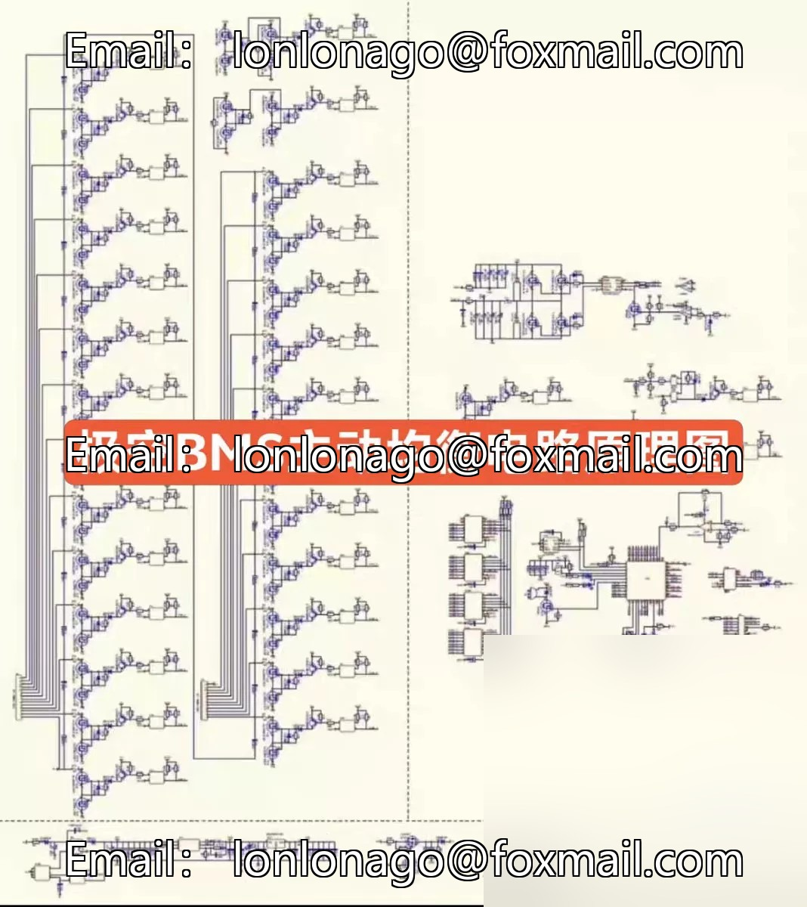
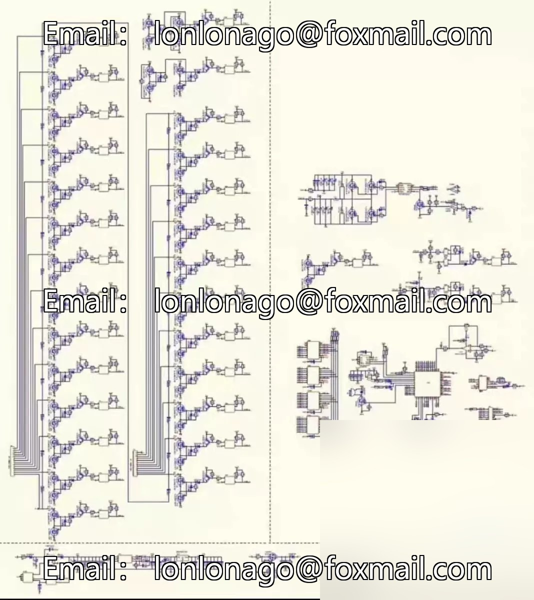

# [Hot] Principle Diagram of Active Balancing Circuit for Extreme Aircraft BMS (Suitable for Learning Principles and Maintenance)

## Body

[hot] Principle Diagram of the Hot BMS Active Equalization Circuit (suitable for learning principles and maintenance use in PDF format. Some chips, transformers do not have model parameters, if you mind please do not bid.

Cool, sold out. No technical support provided! If you need it, just ask.

## Images

## Payment

Here is a pay link on Stripe ( https://buy.stripe.com/3cs8yP7sY87d0vu9AB ). Please contact me lonlonago@foxmail.com after funding $89, and I will send you a complete data files , thank you!

